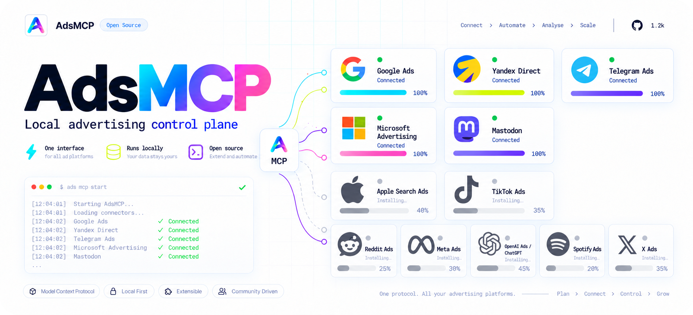

# 🎯 AdsMCP



[English](./README.md) · [Русская версия](./README.ru.md)

**免费使用 AI 智能体管理广告，将数据保存在本地。**

AdsMCP 是一个本地 MCP 服务器，通过统一接口让智能体处理广告活动、支出和分析。
按需连接平台、比较效果，减少重复操作。

我们的目标是让广告更简单：通过熟悉的聊天界面，完成从受众研究到投放和优化的流程，
全程由你掌控。

> 版本 `1.1.1`：本地核心和模块化集成已可用；每个平台都有自己的能力与安全边界。
> 通过智能体完成整个广告流程仍是后续开发目标。

## 目前支持什么

- **汇集数据：**将项目、广告活动、支出和转化保存在本地 SQLite。
- **衡量效果：**计算 CTR、CPC、CPA、ROAS，以及各渠道对转化的贡献。
- **连接平台：**配置相应集成后，可导入 Google Ads、Yandex Direct、Telegram Ads
  和 Microsoft Advertising 的数据。
- **参与社区：**通过 Telegram、Discord 和 Mastodon 连接器了解上下文、开展交流，
  并遵守各渠道的规则。
- **受控自动化：**先进行模拟运行（`dry-run`），外部操作需要明确确认。

首次本地使用只需 MCP 服务器。集成可按需添加；广告账户及其访问权限需要单独配置。

## 集成：已支持与计划中

下表描述配置账户和模块后项目具备的能力。对外部平台的修改需要明确确认。

| 集成 | 完成情况 | 可用功能与限制 |
| --- | --- | --- |
| Google Ads | ✅ 数据导入与部分操作 | 将报告和指标导入 SQLite；通过 API Agent 执行经确认的修改。 |
| Yandex Direct | ✅ 数据导入与部分操作 | 读取统计、修改活动、创建暂停投放的活动；暂不支持删除。 |
| Telegram Ads | ✅ 数据导入与广告管理 | 通过官方 API 获取报告、创建广告、调整预算、提交审核及暂停广告。 |
| Microsoft Advertising / Bing | ✅ 只读 | 读取广告活动、报告并导入指标；未开放活动修改。 |
| Telegram 账户 | ✅ 搜索与交流 | 搜索聊天、私信及公开回复；受 Premium 要求和频率限制约束。 |
| Discord | ✅ 机器人连接器 | 在已授权服务器中，搜索机器人有权访问的频道并发布消息。 |
| Mastodon | ✅ 账户与交流 | OAuth 登录、读取提及通知、回复及更新个人资料。 |
| CRM / Webhook | ✅ 事件接收 | 导入外部提交的转化事件；尚未实现 CRM 管理。 |
| 通过 Click.ru 接入 VK Ads | 🟡 需要手动步骤 | 已接入只读中间服务；首次使用仍需手动关联 VK 广告账户。 |
| Apple Search Ads | 🟡 已备连接模板 | 已配置外部 MCP 读取路径；尚无本地 SQLite 导入功能。 |
| TikTok Ads | 🟡 已备连接模板 | 已准备通过 OAuth 连接外部 MCP 的配置，仅限读取。 |
| Reddit Ads | 🟡 已备连接模板 | 已准备通过外部 MCP 读取广告活动和报告的配置，仅限读取。 |
| Meta Ads | 📋 计划中 | 已定义适配器接口；尚未实现 Graph API 集成。 |
| OpenAI Ads / ChatGPT | 📋 候选方向 | 需要确认 API 可用性及广告账户模型。 |
| Spotify Ads | 📋 候选方向 | 尚未实现 API 和报告集成。 |
| X Ads | 📋 候选方向 | 需要确认 API 访问权限及广告账户要求。 |

详细说明见[集成指南（俄文）](./docs/INTEGRATIONS.ru.md)，
后续开发阶段见[路线图](./docs/ROADMAP.zh.md)。

## 快速开始

需要 **Node.js 22.5+**，以及支持 stdio 的 MCP 客户端，例如 Cursor 或 Claude Desktop。
在下载的仓库目录中运行：

```sh
npm install
npm run build:mcp
```

将以下服务器配置添加到 MCP 客户端，并替换为你自己的路径：

```json
{
  "mcpServers": {
    "ads-mcp": {
      "command": "node",
      "args": ["C:/path/to/AdsMCP/dist/index.js"]
    }
  }
}
```

客户端会自动启动服务器。请智能体检查配置是否正常、是否可以开始使用。
数据默认保存在仓库内的 `data/` 目录中。

使用业务工具前，请通过 `ads_free_use_rules` 阅读[免费使用规则](./docs/FREE-USE-RULES.md)，
再使用 `ads_free_use_accept` 并传入 `confirm=true` 接受当前版本。接受记录只保存在本地
`ADS_MCP_DATA` 目录中。

### GitHub 更新

AdsMCP 启动时每天最多检查一次 GitHub。它会从本地 `origin` 自动识别仓库，
也可以在 `.env` 中设置 `ADSMCP_UPDATE_REPOSITORY=owner/repository`。新的发布版或
标签会下载到 `ADS_MCP_DATA/updates/`，不会覆盖正在运行的安装或凭据。设置
`ADSMCP_UPDATE_ENABLED=false` 可以关闭检查。

AdsMCP 每周会检查本地 Git 中由用户或模块产生的改动。凭据、本地数据、构建产物和被忽略的
安装状态不会发布。只有通用建议的改动可以在 GitHub 设置完成后自动提交 PR；代码、模块、文档
或配置改动会先由 `ads_github_contribution_status` 展示，并要求调用
`ads_github_contribution_create_pr` 且传入 `confirm=true`。

发布前请配置 `ADSMCP_UPSTREAM_REPOSITORY`、个人 `ADSMCP_FORK_REPOSITORY` 和具有 Contents/PR
写权限的 fine-grained `ADSMCP_GITHUB_TOKEN`，然后调用 `ads_github_contribution_setup`。
本地使用不要求 fork，提交 PR 前才要求。设置 `ADSMCP_WEEKLY_PR_ENABLED=false` 可关闭每周检查。

## 文档

| 你想做什么 | 查看文档 |
| --- | --- |
| 配置存储、模块和本地控制面板 | [用户指南（俄文）](./docs/USAGE.ru.md) |
| 连接平台并了解其能力 | [集成指南（俄文）](./docs/INTEGRATIONS.ru.md) |
| 了解项目理念和发展方向 | [产品愿景（俄文）](./docs/PRODUCT-VISION.ru.md) · [路线图](./docs/ROADMAP.zh.md) |
| 了解架构并查找详细说明 | [文档目录（俄文）](./docs/README.ru.md) |

## 一起完善项目

欢迎参与：接入新平台、改进模块和文档、分享你的解决方案。
让我们一起让广告更简单、清晰、易用。
可以从[开发指南（俄文）](./docs/DEVELOPMENT.ru.md)开始。

许可证：[MIT](./LICENSE)。
